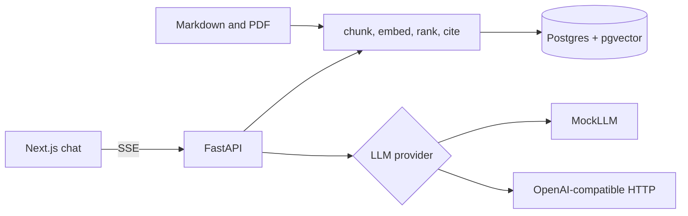

# BookNook shelf assistant

**This is a demo / portfolio project.** It is not a production library system. The reading room, membership rules, and catalog notes are fictional. The only outside text is a short public-domain paragraph from Jane Austen, *Pride and Prejudice* (1813).

BookNook members ask questions about house rules and the books on the lectern. This app ingests those notes, retrieves the passage that matters, and answers in a small chat with a citation back to the source.

## Problem

A one-room bookstore cannot make staff re-read the shelving guide for every "where does this go?" question. The assistant should:

- accept Markdown and PDF notes
- split them into overlapping chunks
- retrieve a few relevant passages
- answer from those passages and show the citation
- keep working with no API key, so the demo can be run and tested offline

## Architecture



`docker compose up` starts Postgres, the API, and the chat UI. With `LLM_PROVIDER=mock` the API quotes the top retrieved note, so the stack answers without an external model.

## Features

- Markdown and PDF ingestion, heading-aware for Markdown and page-aware for PDF
- Overlapping character windows so a rule split across a boundary is still retrievable
- Embeddings behind an `Embedder` protocol. The default is a local hashing embedder
- Postgres + pgvector when `DATABASE_URL` is set; an in-memory shelf otherwise
- `POST /chat` server-sent events: tokens, then citation objects
- Hit-rate script over `sample_data/eval/qa.json`
- Swap the LLM by setting `LLM_PROVIDER=openai` and providing a key in the environment

## Tech stack

- Python 3.12, FastAPI, SQLAlchemy, pgvector, pypdf
- PostgreSQL 16 with pgvector
- Next.js and React
- Ruff, pytest, ESLint, Prettier, Vitest
- Docker Compose and GitHub Actions

## Quickstart

```bash
cp .env.example .env
docker compose up --build
```

- Chat UI: http://localhost:3000
- API: http://localhost:8000/health
- Shelf list: http://localhost:8000/documents

The compose file uses a local database password (`booknook`) so the demo starts without extra setup. Change it before you expose the machine.

Without Docker, from a Python 3.11+ environment:

```bash
pip install -e "./backend[dev]"
cd backend && uvicorn app.main:app --reload
```

That path keeps the shelf in memory and still loads `sample_data/`.

## API examples

Ask a question:

```bash
curl -N -X POST http://localhost:8000/chat \
  -H "Content-Type: application/json" \
  -d "{\"message\": \"Where do mystery novels stay?\"}"
```

A stream looks like:

```text
data: {"token": "From "}
data: {"token": "the "}
data: {"citations": [{"marker": 1, "title": "Shelving guide", "quote": "Mystery novels stay on aisle M..."}]}
data: [DONE]
```

Upload a note:

```bash
curl -X POST http://localhost:8000/documents \
  -F "file=@sample_data/membership.md"
```

Run the retrieval check:

```bash
cd backend && python -m app.eval.run_eval
```

The process exits with status 1 when any sample question misses its document in the top 4.

## Design decisions

- **One protocol for language models.** `MockLLM` and `OpenAICompatibleLLM` both expose `complete` and `stream`. Tests and the default compose file use the mock, so CI never calls a paid API. The OpenAI-compatible client speaks server-sent chat completions, which also covers other vendors that use that shape.
- **Hashing embeddings by default.** A neural embedding model retrieves paraphrases better. It also adds a download and a larger image. Feature hashing is deterministic, has no key, and is good enough for the small BookNook shelf. The `Embedder` protocol is the seam where a local model would go. Vectors are L2-normalized, and pgvector ranks them with cosine distance.
- **Postgres when you want durability, memory when you want a quick run.** Unit tests never start a database. Compose sets `DATABASE_URL`, creates the `vector` extension, and loads the sample shelf only when it is empty.
- **Citations are the top chunks, not a model claim.** The API attaches the retrieved passages after the token stream. The mock model is required to quote the first one. A remote model is instructed to use only those notes.
- **Character windows instead of a tokenizer.** The chunker is easy to test and does not pin a model tokenizer. Heading boundaries are preferred, then a fixed window with overlap.

## Roadmap

- Persist chat transcripts against the optional `session_id`
- Add a sentence-transformer embedder behind the existing protocol
- Score faithfulness (does the answer stay inside the quotes?) in addition to hit rate
- Admin screen for replacing a stale shelving note

## Tests

```bash
cd backend && pytest
cd frontend && npm test
```

GitHub Actions runs Ruff, pytest, ESLint, Prettier, and Vitest.

## Related projects

- [BookNook editorial desk](https://github.com/MiladGhorbaniG/multi-agent-workflow) — planner, researcher, writer, and reviewer
- [BookNook Telegram desk](https://github.com/MiladGhorbaniG/telegram-miniapp-starter) — Mini App, mock membership, and FAQ bot
- [BookNook membership desk](https://github.com/MiladGhorbaniG/booknook-crm) — CRM pipeline, shared job queue, and note-grounded follow-ups
- [Introduction to carried out projects](https://github.com/MiladGhorbaniG/Introduction-to-carried-out-projects) — earlier work, plus the other public repositories
